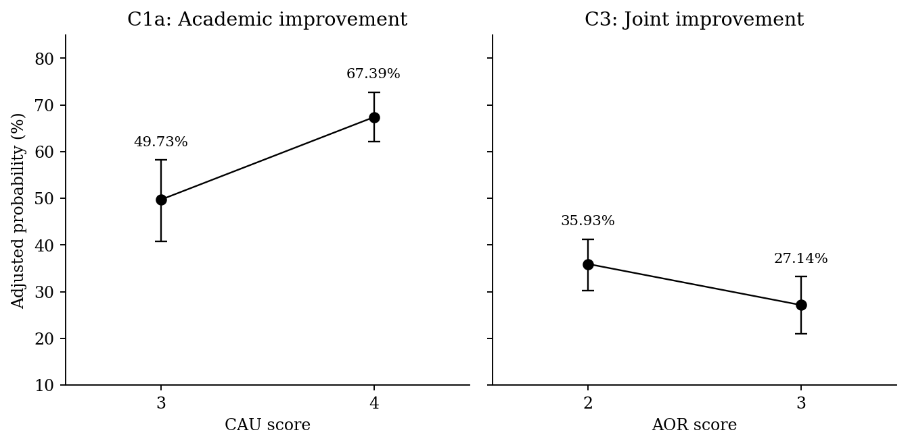

# AI Use, Academic Improvement, and Unaided Self-Study

**An exploratory data science study among academically selected students at Phan Boi Chau High School for the Gifted, Nghe An, Vietnam.**

**Author:** Hoàng Gia Bảo  
**Contact:** hgbao0907@gmail.com

This repository contains the English-language code, recomputed aggregate results, and reproducibility checks supporting the science report. The manuscript will be uploaded separately by the author. The study asks how constructive AI use and AI overreliance relate to reported academic improvement and improvement in unaided self-study.

## Research setting

The Google Forms survey ran from **28 to 30 September 2026**. Invitations were circulated through class monitors. Initial eligibility required membership in a team for provincial or national academic competitions. Of **522 invited students, 358 responded and 323 contributed to the analysis**. The sample is purposive, academically selected, and drawn from one school.

The analysis starts from the retained English export, `data raw eng.csv`. Responses excluded during earlier qualitative screening were not retained. Reproducibility here therefore begins with this export, not with the original recruitment and screening process.

## Main findings

- **C1a:** Constructive AI use was associated with reported academic improvement: OR **1.893 per SD**, 95% profile CI **[1.449, 2.521]**. Model-estimated probabilities at CAU 3 and 4 were **49.73% and 67.39%**.
- **C3:** Greater AI overreliance was associated with lower odds of reporting improvement on both outcomes: OR **0.673 per SD**, 95% profile CI **[0.509, 0.875]**. The AOR 2-to-3 probability contrast was **−8.79 percentage points**, bootstrap CI **[−15.73, −2.57]**.
- **Supplementary C3 analyses:** CAU and AOR had a small positive correlation. The clearer component-level evidence concerned unaided self-study. Separate models do not constitute a formal test that the two outcome associations differ.
- **C1b and C2:** Primary associations had limited robustness across analytical choices.
- **C4 and C5:** The results did not establish predictive superiority of behavior over use quantity or a continuous CAU-by-AOR interaction.
- **C6:** Student perceptions of school guidance provide a descriptive basis for evaluating classroom activities that assess AI-assisted work and unaided application together.

These are **same-cohort, exploratory, observational associations**. The data do not establish causal effects, intervention effectiveness, or external predictive validity.



*Model-estimated probabilities at fixed reference scores. Whiskers are pointwise 95% respondent-bootstrap intervals; the contrasts are descriptive standardizations, not intervention effects.*

## Quick start

Use **Python 3.12**. The numerical environment is pinned in `requirements.txt`.

```bash
git clone https://github.com/HoangGiaBao107/AI-Use-Academic-Improvement-and-Unaided-Self-Study-among-Specialized-High-School-Students.git ai-learning-study
cd ai-learning-study
python -m venv .venv
```

Activate the environment with `source .venv/bin/activate` on macOS/Linux, or `.venv\Scripts\Activate.ps1` in PowerShell. Then:

```bash
python -m pip install -r requirements.txt
# Place the reviewed CSV at data/data raw eng.csv.
python run_pipeline.py --data "data/data raw eng.csv" --workers 4
python scripts/validate.py --data "data/data raw eng.csv" --full
```

The default research settings are **2,000 respondent-bootstrap draws** and **999 parametric-null draws**. Do not interpret a reduced-draw run as the full report reproduction. Running time depends on CPU and worker count; the ordinal and nested-CV stages are the most expensive.

The pipeline does not require earlier phase ZIPs, private workspace paths, or a preprocessed dataset. It recomputes the analytical cohort and report-linked results from the original CSV.

## Phases

| Phase | Entry point | Outputs and purpose |
|---|---|---|
| 1 | `phases/01_data_and_codebook.py` | Input identity, cohort flow, missingness, quality flags, and English item dictionary. |
| 2 | `phases/02_measurement_and_descriptives.py` | Demographics, outcome combinations, reliability, descriptive correlations, sparse cells, and school-item distributions. |
| 3 | `phases/03_adjusted_associations.py` | C1a/C1b/C2/C3, the two C3 component models, profile intervals, sensitivity specifications, and BH-FDR scopes. |
| 4 | `phases/04_bootstrap_and_null_checks.py` | Paired respondent bootstrap, standardized probability intervals, CAU–AOR correlation, and C3 null simulation. Requires Phase 3. |
| 5 | `phases/05_prediction_and_calibration.py` | Fixed-candidate repeated CV, nested selection, all 45 log-loss comparisons, and the separate two-repeat calibration diagnostic. |
| 6 | `phases/06_interaction_and_school_context.py` | Ten continuous-interaction tests, primary interaction resampling, and classroom-context tables. |
| 7 | `phases/07_tables_figures_and_downloads.py` | Main evidence tables, monochrome figures, HTML tables, and downloadable table bundles. Requires previous outputs. |

Run a subset, for example:

```bash
python run_pipeline.py --data "data/data raw eng.csv" --phases 1,2,3
python phases/04_bootstrap_and_null_checks.py --data "data/data raw eng.csv"
```

The optional [notebook](notebooks/reproduce_report.ipynb) exposes the same seven phases, displays the resulting tables, and includes download instructions after each phase. It calls the same source code as the command-line pipeline.

## Results and downloads

- [Main model results](results/tables/07_report_outputs/main_results.csv)
- [C3 component models](results/tables/07_report_outputs/component_results.csv)
- [All tables, organized by phase](results/index.md)
- [Download all tables](results/downloads/all_tables.zip)
- [HTML table collection](results/tables.html) — download and open locally.
- [Figures](results/figures)
- [Five-round verification report](results/verification/five_round_review.md)
- [Claim-to-code traceability](docs/CLAIM_TRACEABILITY.md)
- [Complete repository structure](docs/REPOSITORY_TREE.md)

Each phase also has a ZIP under `results/downloads/`. Tables are CSV files with unrounded or high-precision values; the report rounds values for presentation. OOF predictions, fitted design matrices, and individual response intermediates stay local in `.work/`.

## Statistical and reproducibility details

- **Outcomes:** N1 improvement and N3 improvement mean either increase response. Joint improvement requires both. N2 is excluded because of content overlap. N1 and N3 have different recall windows.
- **Scores:** CAU/AOR use complete-item means. Higher AOR means greater overreliance. The scales are self-developed; alpha alone does not establish validity.
- **Associations:** Firth logistic regression, fixed-design penalized likelihood-ratio tests, profile penalized-likelihood intervals, and standardized probabilities. The primary predictors and covariates are retained without p-based selection.
- **Sensitivity:** Alternative item content, flagged-record inclusion, A7 adjustment, B2 coding, expanded covariates, and nonlinear scores. Ten C3 specifications assess one focal association and are not independent replications.
- **Multiplicity:** BH-FDR only. The historical 80-, 20-, 10-, 144-, and 154-test scopes remain explicit. The two reviewer-requested component tests also show two-test and augmented 156-test scopes. These scopes do not account for every analytical decision made during exploration.
- **Historical tests:** `provenance/historical_tests.csv` retains 84 earlier out-of-scope p-values needed to reconstruct the report's adjustment scopes. They are provenance inputs, not newly fitted findings. All 72 in-scope association tests are fitted again from the raw CSV. Validation snapshots are stored separately under `provenance/reference/` and are never used to manufacture analysis results.
- **Prediction:** Five-fold CV repeated three times; nested selection uses five outer and three inner folds. Scaling is fitted in training folds. Prediction intervals bootstrap fixed person-level OOF losses; they do not include complete model-retraining uncertainty. PO/PPO assumptions and numerical failures remain visible.
- **Calibration:** A separate five-fold, twice-repeated multinomial diagnostic reproduces the report's calibration figure and values. It is not substituted for the nested predictive comparison.
- **Uncertainty:** Original seed schemes, respondent pairing, score scales, and spline knots are retained. Machine-level floating-point differences are checked against declared tolerances.

## Scope of this release

This is a focused reproduction of the analyses used in the report's conclusions and their supporting diagnostics. The older profile-clustering branch and verification-behavior candidate are not rerun because they do not support the main conclusions. Their historical p-values are retained only where required for multiplicity provenance. Static methodological explanations and bibliography entries are not numerical analyses. The [traceability document](docs/CLAIM_TRACEABILITY.md) identifies the exact coverage.

Five verification rounds cover source integrity, independent raw-data checks and numerical refits, agreement with report evidence, a fresh full-pipeline replay, and publication-package integrity. They assess reproducibility and consistency, not construct validity or causal identification.

## Adding the manuscript

Upload the final science report to `report/science_report.pdf` and optionally its LaTeX source to `report/science_report.tex`. Update the manuscript link in `report/README.md`. No manuscript PDF is included in this initial code release.

## Citation, assistance, and license

Use the repository's `CITATION.cff` to cite this software. ChatGPT assisted with code development, computational checks, and documentation; this assistance is also disclosed in the manuscript. The author is responsible for the research and interpretation.

See [LICENSE](LICENSE) for the MIT software license. Respondent-level data are not distributed with the software. The manuscript is maintained separately.
